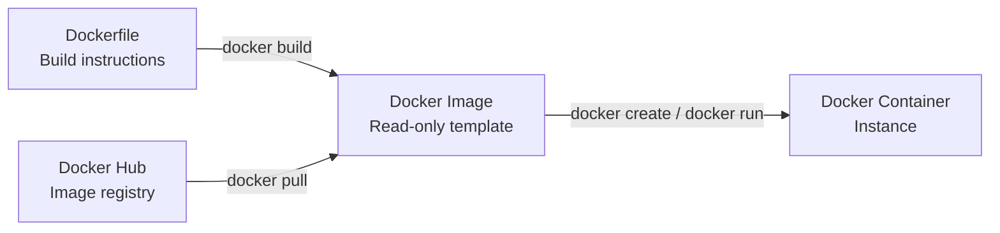
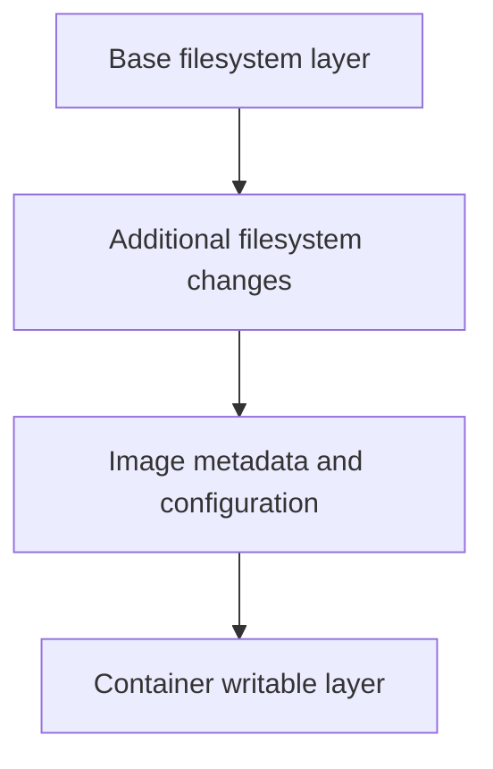
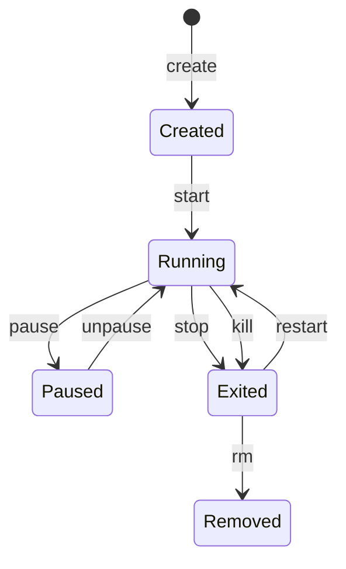

# Day 30 Docker Images & Container Lifecycle

**90 Days of DevOps** · Docker | Linux | Containerization | Troubleshooting

## Docker workflow at a glance



- **Dockerfile → Image → Container:** define the build, create an image, then create or run a container.
- **Docker Hub → Image → Container:** pull a published image locally, then create or run a container from it.
- This day focused on pulling and inspecting images, managing container states, using `logs`/`exec`/`inspect`, and cleanup.

## 1. Docker images

### Pull and list

```bash
docker pull nginx:latest
docker pull ubuntu:latest
docker pull alpine:latest
docker image ls
```

| Image | Purpose | Size evidence |
|---|---|---|
| `nginx:latest` | Nginx web server | Record from `docker image ls` |
| `ubuntu:latest` | General-purpose Linux base | Record from `docker image ls` |
| `alpine:latest` | Minimal Linux base | Your output showed **13 MB disk usage** and **3.94 MB content size** |

### Ubuntu vs Alpine

| Ubuntu | Alpine |
|---|---|
| Broader user-space and common utilities | Minimal user-space and BusyBox utilities |
| `apt` package manager | `apk` package manager |
| Uses glibc | Uses musl libc |
| Generally larger base image | Generally smaller base image |

**Takeaway:** Alpine can reduce image transfer and storage size. Check application compatibility and debugging needs before choosing a base image.

### Inspect and remove an image

```bash
docker image inspect nginx:latest
docker image inspect --format '{{.Os}}/{{.Architecture}}' nginx:latest
docker image inspect --format '{{json .Config.ExposedPorts}}' nginx:latest
docker image inspect --format '{{json .RootFS.Layers}}' nginx:latest
```

Inspect can show image ID, tags, creation time, OS/architecture, environment, entrypoint, command, declared ports and layer identifiers. `EXPOSE` documents a container port; it does not publish a host port.

Before removing an image, check references:

```bash
docker ps -a --filter ancestor=alpine:latest
docker image rm alpine:latest
docker image ls
```

> Remove only an image you no longer need. A stopped container can still reference its image, and deleting a local image does not delete a copy already pushed to Docker Hub.

## 2. Image layers and cache

```bash
docker image history nginx:latest
docker image history --no-trunc nginx:latest
```



- **Layers:** reusable, read-only filesystem changes that make up an image.
- **`0B` history entries:** often metadata instructions such as `CMD`, `ENV`, `ENTRYPOINT`, `EXPOSE`, or `LABEL` that do not add filesystem content.
- **Caching:** Docker can reuse unchanged build steps.
- **Sharing:** images can reuse common layers, reducing repeated downloads and storage.
- **Build tip:** put stable dependency steps before frequently changing application files when practical.

## 3. Container lifecycle

Check `docker ps -a` after each operation so you can observe the state change.



Use a dedicated test container name such as `day30-lifecycle`:

```bash
docker create --name day30-lifecycle nginx:latest
docker ps -a
docker start day30-lifecycle
docker ps -a
docker pause day30-lifecycle
docker ps -a
docker unpause day30-lifecycle
docker ps -a
docker stop day30-lifecycle
docker ps -a
docker restart day30-lifecycle
docker ps -a
docker kill day30-lifecycle
docker ps -a
docker rm day30-lifecycle
docker ps -a
```

| Command | State to look for |
|---|---|
| `create` | `Created` |
| `start`, `unpause`, `restart` | `Up` |
| `pause` | `Up (Paused)` |
| `stop`, `kill` | `Exited` |
| `rm` | Container no longer listed |

`docker stop` attempts a graceful shutdown. `docker kill` sends `SIGKILL` by default. The actual exit code can vary.

## 4. Working with a running Nginx container

Your earlier terminal output showed `day29-nginx` already publishing host port `8080`. Use `8081` for the Day 30 example to avoid a port conflict.

### Run Nginx and view logs

```bash
docker run -d --name day30-nginx -p 8081:80 nginx:latest
docker ps
curl -I http://localhost:8081
docker logs day30-nginx
curl http://localhost:8081
docker logs --tail 20 day30-nginx
docker logs -f day30-nginx
```

- `-d` runs the container in the background.
- `-p 8081:80` maps host port `8081` to container port `80`.
- `docker logs -f` follows new entries; press **Ctrl+C** to stop following logs without stopping the container.

### Explore with `exec`

```bash
docker exec -it day30-nginx sh
```

Inside the container, try:

```sh
pwd
ls -la /
ls -la /etc/nginx
ls -la /usr/share/nginx/html
cat /etc/os-release
exit
```

Run a command without opening an interactive shell:

```bash
docker exec day30-nginx nginx -v
docker exec day30-nginx cat /etc/os-release
```

> `/etc/os-release` is a file, not an executable command. Use `cat /etc/os-release` to display it.

### Inspect IP, ports, and mounts

```bash
docker inspect day30-nginx
docker inspect --format '{{range .NetworkSettings.Networks}}{{.IPAddress}}{{end}}' day30-nginx
docker port day30-nginx
docker inspect --format '{{json .Mounts}}' day30-nginx
```

- `docker inspect` reports configuration, state, network information, and mounts.
- The container IP is usually internal to the Docker network.
- An empty mount list is normal if no volume or bind mount was configured.
- To access Nginx from outside EC2, allow inbound TCP `8081` in the instance's security group.

## 5. Cleanup and disk usage

> **Caution:** These commands affect the whole Docker host, including unrelated containers. Review `docker ps -a` before running them.

```bash
# Review resources first
docker ps -a
docker system df

# Stop every running container
docker ps -q | xargs -r docker stop

# Remove all stopped containers (confirm when prompted)
docker container prune

# Remove dangling images
docker image prune

# Optional: remove all images not referenced by a container
docker image prune -a

# Check final usage
docker ps -a
docker image ls
docker system df
docker system df -v
```

- `docker container prune` removes stopped containers.
- `docker image prune` removes dangling images; `-a` removes a broader set of unused images.
- `docker system df` summarizes Docker storage for images, containers, volumes, and build cache.
- Compare before/after output to see how much storage was reclaimed.

## Key takeaways

- **Image:** read-only template; **container:** instance with its own writable layer.
- **Layers and cache:** improve reuse, distribution, and build efficiency.
- **Lifecycle commands:** make container states visible and predictable.
- **`logs`, `exec`, `inspect`:** core tools for runtime troubleshooting.
- **Cleanup:** check resources first; prune commands can remove resources you may still need.

## Screenshot evidence

Saved the own terminal screenshots under `screensho/`.

- [ ] `01-pull-and-list-images.png`
- [ ] `02-image-inspect.png`
- [ ] `03-image-history-layers.png`
- [ ] `04-container-lifecycle.png`
- [ ] `05-container-logs-and-exec.png`
- [ ] `06-container-inspect.png`
- [ ] `07-container-cleanup-disk-usage.png`


